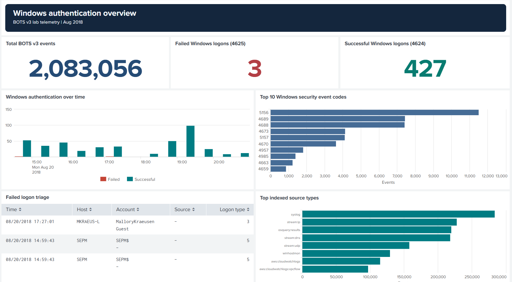
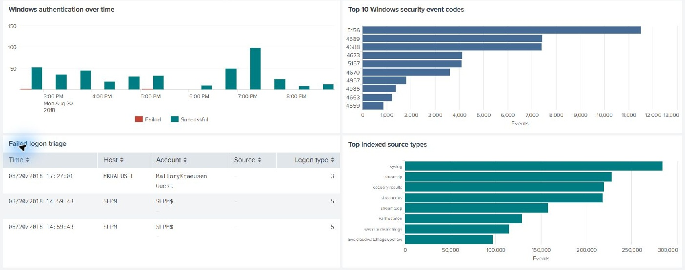

# BOTS v3 SOC Monitoring Dashboard

A seven-panel Splunk Enterprise dashboard for Windows authentication monitoring and Level 1 triage, built using the historical [Boss of the SOC v3 practice dataset](https://github.com/splunk/botsv3).

## Investigation workflow

1. Use the time picker to scope the search. The default is All time for the historical lab data.
2. Compare successful Windows logons (4624) and failed Windows logons (4625) on the timeline.
3. Review the failed-logon table for the event time, host, account, source, and logon type. Pivot to the original event before deciding whether to escalate.
4. Check the event-code and source-type charts to understand what telemetry is available.

In this lab, the full index contained **2,083,056 events**. The Windows Security searches returned **427 successful logon events** and **3 failed logon events**. The failed events showed `-` for the source address, so the table alone cannot establish the origin of the activity. These are event counts from the lab dataset.

## Reproduce in Splunk

1. Install the BOTS v3 dataset and confirm that the `botsv3` index is searchable.
2. Create a Classic Dashboard in Splunk Enterprise, open **Edit → Source**, and paste [dashboard.xml](dashboard.xml).
3. Save it and use **All time** to see historical events. Field availability can vary with the installed add-ons.
